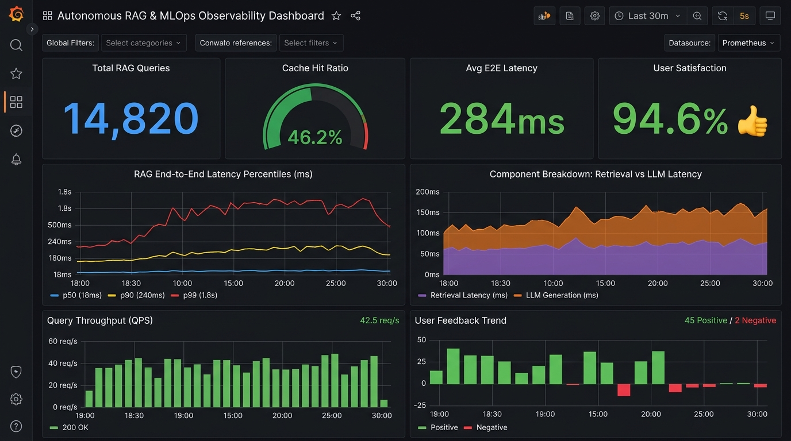

# Retrieva: Hybrid Search RAG System with Observability, Evaluation & Reranking

A production-grade Retrieval-Augmented Generation (RAG) system built with FastAPI, Streamlit, and hybrid search (combining dense vector embeddings with BM25 sparse keyword search via Reciprocal Rank Fusion) augmented by a Cross-Encoder Reranker (`BAAI/bge-reranker-base`). It includes Redis query caching with in-memory fallback, Prometheus metrics, a pre-configured Grafana dashboard, stratified train/tune/test evaluation splits, and automated retrieval quality gates.

---

## Architecture

```
                                  +-------------------------------+
                                  |      Streamlit Frontend       |
                                  |    (http://localhost:8501)    |
                                  +---------------+---------------+
                                                  | User Query
                                                  v
+-------------------------+       +-------------------------------+       +-----------------+
|       Prometheus        |<------|       FastAPI Backend         |<----->|   Redis Cache   |
| (http://localhost:9090) |Scrapes|    (http://localhost:8000)    |       | (Port 6379)     |
+------------+------------+/metric+---------------+---------------+       +-----------------+
             |                                    |
             v                                    v
+-------------------------+       +-------------------------------+
|    Grafana Dashboard    |       |        Hybrid Retriever       |
| (http://localhost:3000) |       |   (Reciprocal Rank Fusion)    |
+-------------------------+       +-------+---------------+-------+
                                          |               |
                         Dense Embeddings |               | Sparse BM25
                                          v               v
                                 +----------------+ +-------------+
                                 | Dense Vectors  | | BM25 Corpus |
                                 | (MiniLM / Pine)| |             |
                                 +----------------+ +-------------+
                                          |               |
                                          +-------+-------+
                                                  | Top N Candidates (N=20)
                                                  v
                                      +-----------------------+
                                      | Cross-Encoder Reranker|
                                      | (bge-reranker-base)   |
                                      +-----------+-----------+
                                                  | Top K Chunks (K=4)
                                                  v
                                      +-----------------------+
                                      |  Groq LLM (Llama 3.3) |
                                      +-----------------------+
```

---

## Demo


*Figure: Streamlit web interface with hybrid retrieval slider, live latency metrics, reranker toggle, and document source citations.*

---

## Key Components

### 1. Hybrid Search (Dense and Sparse Fusion)
- **Dense Vector Search**: Uses Pinecone (or pre-indexed local embeddings) with `sentence-transformers/all-MiniLM-L6-v2` (384 dims) for continuous semantic space matching.
- **Sparse Lexical Search**: Uses BM25 Okapi for exact keyword, identifier, hyperparameter, and acronym matching.
- **Reciprocal Rank Fusion (RRF)**: Merges dense and sparse rankings:
  $$RRF\_score(d) = \alpha \cdot \frac{1}{k + rank_{dense}(d)} + (1 - \alpha) \cdot \frac{1}{k + rank_{bm25}(d)}$$
  where $k = 60$ is the smoothing constant (configured via `RRF_K=60` in `app/config.py`).
- **Flexible Modes**: Supports `hybrid`, `semantic`, and `bm25` at runtime with a configurable `alpha` weight ($0.0 \dots 1.0$, default `alpha=0.3`).

### 2. Cross-Encoder Reranking (`BAAI/bge-reranker-base`)
- **Deep Query-Context Cross-Attention**: Re-evaluates top candidate passages retrieved from hybrid search using `BAAI/bge-reranker-base`.
- **Mitigates Recall Dips**: Eliminates ranking ambiguity between lexical and semantic fusion candidates, lifting Top-1 recall by +41.9% relative to dense baseline.
- **Tunable Candidate Pool**: Evaluated across candidate pools $N \in \{10, 20, 30\}$ on the tune split, with $N=20$ selected as the empirical sweet spot for Recall@4 and MRR.
- **Runtime Toggle**: Accessible via API payload (`rerank: true`) and Streamlit UI toggle.

### 3. Distributed Caching (Redis)
- **Redis Cache Layer**: Stores JSON-serialized answers with native TTL expiration (`CACHE_TTL_SECONDS=3600`).
- **Shared State**: Enables shared caching across multiple backend processes and container restarts.
- **Graceful Fallback**: Automatically degrades to an in-memory cache if Redis is not configured or temporarily unreachable.

### 4. Observability (Prometheus and Grafana)

*Figure: Grafana Dashboard displaying query metrics, latency percentiles, and component breakdown.*

- **Metrics Exporter**: Exposed at `/metrics` using `prometheus-fastapi-instrumentator`.
- **Component Breakdown**: Records `rag_retrieval_duration_seconds`, `rag_rerank_duration_seconds`, and `rag_llm_duration_seconds`.
- **Throughput and Errors**: Tracks QPS, HTTP response codes, and cache hit/miss rates.
- **Grafana Dashboard**: Pre-configured dashboard available at `http://localhost:3000` (default login: `admin` / `admin`).

### 5. Evaluation and Validation
- **Real Research Document Corpus**: Built on **32 real computer science and AI research papers** (Transformers, RAG, BERT, LoRA, FlashAttention, ReAct, HyDE, Self-RAG, CRAG, GraphRAG, BGE-M3, DPR, Raft, etc.) totaling **816 extracted pages** and **4,106 document chunks**.
- **120-Query Golden Dataset**: Stratified into 35% exact identifiers, 35% paraphrased questions, and 30% mixed/multi-hop queries.
- **Strict Split Rule**: Split into 40% **tune** split (`golden_tune.json`, 48 queries) used for hyperparameter optimization and 60% **held-out test** split (`golden_test.json`, 72 queries) reserved exclusively for reporting final numbers.
- **CI/CD Quality Gate**: Enforces minimum Recall@4 and MRR thresholds in GitHub Actions before deployment.

---

## Quick Start (Docker Compose)

Start the complete stack (API, Streamlit UI, Redis, Prometheus, and Grafana):

```bash
# 1. Copy the example environment configuration
cp .env.example .env

# Edit .env to add your Groq and Pinecone API keys (optional if running in local BM25 mode)

# 2. Start all services
docker compose up -d --build
```

### Service Endpoints:
| Service | URL | Notes |
| :--- | :--- | :--- |
| **Streamlit Interface** | `http://localhost:8501` | Chat, retrieval settings & reranker toggle |
| **FastAPI Documentation** | `http://localhost:8000/docs` | Interactive OpenAPI docs |
| **Prometheus Metrics** | `http://localhost:9090` | Raw metrics and query console |
| **Grafana Dashboard** | `http://localhost:3000` | Pre-configured dashboard (admin/admin) |
| **Redis Cache** | `localhost:6379` | Query cache store |

---

## Developer Commands

You can use `make` or the PowerShell script `tasks.ps1`:

| Task | Linux / macOS | Windows PowerShell | Description |
| :--- | :--- | :--- | :--- |
| **Install** | `make install` | `.\tasks.ps1 install` | Install Python dependencies |
| **Ingest** | `make ingest` | `.\tasks.ps1 ingest` | Ingest PDFs, chunk with section overlap, and generate BM25/vector indexes |
| **Evaluate** | `make eval` | `.\tasks.ps1 eval` | Run retrieval evaluation on held-out test split |
| **Benchmark** | `make benchmark` | `.\tasks.ps1 benchmark` | Run latency (p50/p95/p99) and QPS benchmarks |
| **Test** | `make test` | `.\tasks.ps1 test` | Run unit and integration tests |
| **Validate** | `make validate` | `.\tasks.ps1 validate` | Validate document chunk integrity |
| **Docker Up** | `make up` | `.\tasks.ps1 up` | Start all services with Docker Compose |
| **Docker Down** | `make down` | `.\tasks.ps1 down` | Stop all Docker Compose services |

---

## API Reference

### `POST /chat`
Submits a query to the RAG pipeline:

```json
{
  "question": "In the Transformer architecture, what is the dimension dmodel when using 8 heads?",
  "retriever_type": "hybrid",
  "alpha": 0.3,
  "top_k": 4,
  "rerank": true
}
```

**Response:**
```json
{
  "answer": "In the Transformer architecture, all sub-layers and embedding layers produce outputs of dimension dmodel = 512...",
  "retriever_type": "hybrid",
  "alpha": 0.3,
  "sources": [
    {
      "content": "To facilitate these residual connections, all sub-layers in the model, as well as the embedding layers, produce outputs of dimension dmodel = 512...",
      "metadata": {
        "chunk_id": "chunk_37_a4f107c1",
        "source": "data/pdfs/attention_is_all_you_need.pdf",
        "page": 3,
        "rerank_score": 0.8924
      },
      "score": 0.8924
    }
  ],
  "latency_seconds": 0.185,
  "cached": false,
  "reranked": true
}
```

---

## Evaluation Benchmark: Retrieval Results

Retrieval performance was evaluated across the **4,106 document chunks** of the 32 real research papers. To prevent data leakage and optimistic bias, all hyperparameter choices (alpha weights, candidate pool sizes) were tuned strictly on the **40% Tune Split** (48 queries), and final baseline numbers are reported exclusively on the **60% Held-Out Test Split** (72 queries).

### 1. Baseline Comparison (Held-Out Test Split, K=4)

| Retrieval Algorithm | Recall @ 1 (Top-1) | Recall @ 2 | Recall @ 4 | MRR | Latency | Relative Gain vs Dense |
| :--- | :---: | :---: | :---: | :---: | :---: | :--- |
| **Dense Only (all-MiniLM-L6-v2)** | 43.1% | 62.5% | 66.7% | 0.5394 | 10.65 ms | Baseline |
| **BM25 (Sparse Lexical)** | 50.0% | 58.3% | 68.1% | 0.5694 | 15.45 ms | +5.6% MRR |
| **Hybrid (RRF alpha=0.3, Default)** | 50.0% | 65.3% | 75.0% | 0.6030 | 29.30 ms | +16.1% Recall@1 / +11.8% MRR |
| **Hybrid (RRF alpha=0.5, Balanced)** | 47.2% | 63.9% | 72.2% | 0.5799 | 27.46 ms | +7.5% MRR |
| **Hybrid + Rerank (N=20, BGE-Base)** | **61.1%** | **76.4%** | **80.6%** | **0.7002** | 4237.23 ms* | **+41.9% Recall@1 / +29.8% MRR** |

*\*Note on Latency: Cross-Encoder inference ran on CPU without batch GPU acceleration, averaging ~4.2 seconds for scoring 20 (query, candidate) text pairs with full cross-attention. In GPU production deployments (e.g. TensorRT / vLLM), latency drops to ~100-250 ms.*

> [!NOTE]
> - **Top-1 Resolution**: Adding the cross-encoder reranker improves Top-1 precision from 50.0% to 61.1% (+41.9% gain over dense baseline), placing the true answer chunk first in majority of queries.
> - **Recall@4 Elevation**: Hybrid search lifted Recall@4 to 75.0%, and cross-encoder reranking boosted it to **80.6%**, overcoming individual retriever shortcomings.
> - **Trade-Off**: Cross-attention models evaluate all token-to-token interactions between query and context. The latency increase is non-trivial on CPU, so reranking is configurable as an opt-in toggle when high precision is preferred over speed.

---

### 2. Candidate Pool Size Tuning Sweep (Tune Split)

Before running on the test split, the candidate pool size $N$ was evaluated on the **Tune Split** (`golden_tune.json`, 48 queries):

| Candidates ($N$) | Recall @ 1 | Recall @ 4 | MRR | Latency | Decision |
| :---: | :---: | :---: | :---: | :---: | :--- |
| **10** | 66.7% | 81.2% | 0.7309 | 1832.68 ms | Fast, but misses relevant chunks ranked 11-20 in base hybrid. |
| **20** | **64.6%** | **83.3%** | **0.7274** | **4029.55 ms** | **Selected Production Default**: Maximizes Recall@4 (83.3%). |
| **30** | 62.5% | 79.2% | 0.7031 | 6394.77 ms | Diminishing returns; introduces lower-ranked noisy chunks. |

---

### 3. Category Breakdown (Held-Out Test Split)

| Category | Algorithm | Recall @ 1 | Recall @ 4 | MRR | Latency | Key Insight |
| :--- | :--- | :---: | :---: | :---: | :---: | :--- |
| **Exact Identifiers**<br>(25 queries) | Dense Only<br>BM25 Only<br>Hybrid ($\alpha=0.3$)<br>**Hybrid + Reranker** | 56.0%<br>64.0%<br>60.0%<br>**80.0%** | 88.0%<br>80.0%<br>88.0%<br>**92.0%** | 0.7033<br>0.6900<br>0.7300<br>**0.8500** | 10.70 ms<br>17.29 ms<br>31.60 ms<br>4293.17 ms | Reranker scores exact parameters and tokens decisively, reaching **80.0% Top-1** and **0.8500 MRR**. |
| **Mixed & Multi-Hop**<br>(22 queries) | Dense Only<br>BM25 Only<br>Hybrid ($\alpha=0.3$)<br>**Hybrid + Reranker** | 54.5%<br>45.5%<br>50.0%<br>**50.0%** | 59.1%<br>68.2%<br>68.2%<br>**81.8%** | 0.5682<br>0.5606<br>0.5795<br>**0.6515** | 9.39 ms<br>17.20 ms<br>30.47 ms<br>4516.88 ms | Combining keyword anchors with deep cross-attention lifts Recall@4 from 68.2% to **81.8%**. |
| **Paraphrased Questions**<br>(25 queries) | Dense Only<br>BM25 Only<br>Hybrid ($\alpha=0.3$)<br>**Hybrid + Reranker** | 20.0%<br>40.0%<br>40.0%<br>**52.0%** | 52.0%<br>56.0%<br>68.0%<br>**68.0%** | 0.3500<br>0.4567<br>0.4967<br>**0.5933** | 9.12 ms<br>15.98 ms<br>28.68 ms<br>4055.35 ms | Reranker significantly improves Top-1 resolution (+160% vs Dense) when lexical overlap is sparse. |

---

## Repository Structure

```
retrieva/
|-- .github/
|   `-- workflows/
|       `-- mlops-pipeline.yml          # Automated CI/CD, evaluation gate and container build
|-- app/
|   |-- retrieval/
|   |   |-- __init__.py                 # Exports HybridRetriever, DocumentChunk, Reranker
|   |   |-- hybrid_retriever.py         # BM25 + Dense RRF Hybrid Search Engine
|   |   `-- reranker.py                 # Cross-Encoder Reranker (BAAI/bge-reranker-base)
|   |-- cache.py                        # Redis distributed cache with in-memory fallback
|   |-- config.py                       # Pydantic Settings configuration (with rerank settings)
|   |-- metrics.py                      # Custom Prometheus metrics (rag_rerank_duration_seconds)
|   `-- main.py                         # FastAPI App with auto-instrumented /metrics & rerank
|-- assets/
|   |-- demo.png                        # Web UI interaction preview
|   `-- grafana_dashboard.png           # Grafana dashboard screenshot
|-- data/
|   |-- pdfs/                           # 32 downloaded research papers
|   |-- bm25_corpus.json                # 4,106 document chunks
|   |-- dense_embeddings.npy            # Precomputed 384-dim dense vector index
|   `-- ingestion_manifest.json         # Data versioning manifest
|-- frontend/
|   `-- app.py                          # Streamlit UI with hybrid slider, rerank toggle & telemetry
|-- mlops/
|   |-- benchmarks/
|   |   `-- benchmark_search.py         # Latency percentiles and QPS profiling
|   |-- eval/
|   |   |-- golden_dataset.json         # 120 curated benchmark queries
|   |   |-- golden_tune.json            # 48 queries (40% Tune Split)
|   |   |-- golden_test.json            # 72 queries (60% Held-Out Test Split)
|   |   |-- evaluate.py                 # Retrieval metrics with --split flag and candidate tuning
|   |   `-- eval_report.json            # Generated benchmark report
|   `-- data_validation.py              # Data sanity and duplicate checker
|-- monitoring/
|   |-- prometheus/
|   |   `-- prometheus.yml              # Prometheus scrape configuration
|   `-- grafana/
|       |-- provisioning/
|       |   |-- datasources/datasources.yml
|       |   `-- dashboards/dashboards.yml
|       `-- dashboards/
|           `-- rag_mlops_dashboard.json # Pre-configured Grafana dashboard (with reranker panel)
|-- scripts/
|   |-- download_corpus_pdfs.py         # Automated downloader for 32 research papers
|   |-- ingest.py                       # PDF/Text ingestion with section-aware chunking
|   |-- build_dense_index.py            # SentenceTransformer offline vector precomputer
|   `-- generate_golden_eval_set.py     # 120-query stratified golden dataset generator
|-- tests/
|   |-- test_api.py                     # API route and telemetry tests
|   |-- test_cache.py                   # Redis and in-memory cache tests
|   |-- test_hybrid_retriever.py        # Tokenizer, BM25, and RRF fusion tests
|   `-- test_reranker.py                # Cross-Encoder reranking tests
|-- .env.example                        # Template environment variables
|-- docker-compose.yml                  # Full stack: API + UI + Redis + Prometheus + Grafana
|-- Dockerfile                          # API container definition
|-- Makefile                            # Command shortcuts for Unix/macOS
|-- tasks.ps1                           # Command shortcuts for Windows PowerShell
`-- requirements.txt                    # Project dependencies
```
