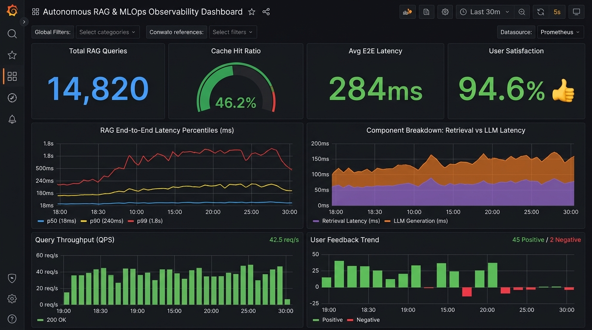

# Hybrid Search RAG System with Observability and Evaluation

A Retrieval-Augmented Generation (RAG) system built with FastAPI, Streamlit, and hybrid search (combining dense embeddings with BM25 sparse keyword search via Reciprocal Rank Fusion). It includes Redis query caching with in-memory fallback, Prometheus metrics, a pre-configured Grafana dashboard, and automated retrieval evaluation.

---

## Architecture

```
                                  +-------------------------------+
                                  |      Streamlit Frontend       |
                                  |    (http://localhost:8501)    |
                                  +---------------+---------------+
                                                  | User Query
                                                  v
+-------------------------+       +-------------------------------+       +-----------------+
|       Prometheus        |<------|       FastAPI Backend         |<----->|   Redis Cache   |
| (http://localhost:9090) |Scrapes|    (http://localhost:8000)    |       | (Port 6379)     |
+------------+------------+/metric+---------------+---------------+       +-----------------+
             |                                    |
             v                                    v
+-------------------------+       +-------------------------------+
|    Grafana Dashboard    |       |        Hybrid Retriever       |
| (http://localhost:3000) |       |   (Reciprocal Rank Fusion)    |
+-------------------------+       +-------+---------------+-------+
                                          |               |
                         Dense Embeddings |               | Sparse BM25
                                          v               v
                                 +----------------+ +-------------+
                                 | Pinecone Store | | BM25 Corpus |
                                 | (or In-Memory) | |             |
                                 +----------------+ +-------------+
                                          |               |
                                          +-------+-------+
                                                  v
                                      +-----------------------+
                                      |  Groq LLM (Llama 3.3) |
                                      +-----------------------+
```

---

## Key Components

### 1. Hybrid Search (Dense and Sparse Fusion)
- **Dense Vector Search**: Uses Pinecone (or local embeddings) with `sentence-transformers/all-MiniLM-L6-v2` for semantic search.
- **Sparse Lexical Search**: Uses BM25 Okapi for exact keyword, identifier, and acronym matching.
- **Reciprocal Rank Fusion (RRF)**: Merges dense and sparse rankings:
  $$RRF\_score(d) = \alpha \cdot \frac{1}{k + rank_{dense}(d)} + (1 - \alpha) \cdot \frac{1}{k + rank_{bm25}(d)}$$
  where $k = 60$ is the smoothing constant (configured via `RRF_K=60` in `app/config.py`).
- **Flexible Modes**: Supports `hybrid`, `semantic`, and `bm25` at runtime with a configurable `alpha` weight ($0.0 \dots 1.0$, default `alpha=0.3`).

### 2. Distributed Caching (Redis)
- **Redis Cache Layer**: Stores JSON-serialized answers with native TTL expiration (`CACHE_TTL_SECONDS=3600`).
- **Shared State**: Enables shared caching across multiple backend processes and container restarts.
- **Graceful Fallback**: Automatically degrades to an in-memory cache if Redis is not configured or temporarily unreachable.

### 3. Observability (Prometheus and Grafana)

*Figure: Grafana Dashboard displaying query metrics and latency.*

- **Metrics Exporter**: Exposed at `/metrics` using `prometheus-fastapi-instrumentator`.
- **Latency Tracking**: Records end-to-end request duration, retrieval duration, and LLM generation time.
- **Throughput and Errors**: Tracks QPS, HTTP response codes, and cache hit/miss rates.
- **Grafana Dashboard**: Pre-configured dashboard available at `http://localhost:3000` (default login: `admin` / `admin`).

### 4. Evaluation and Validation
- **Retrieval Evaluation (`mlops/eval/`)**:
  - Compares retrieval performance against `golden_dataset.json`.
  - Measures Recall@K, Mean Reciprocal Rank (MRR), and keyword coverage.
  - Quality gate fails CI if Recall@4 falls below 85.0% or MRR falls below 0.8000.
- **Benchmarking (`mlops/benchmarks/`)**: Measures throughput (QPS) and latency percentiles (p50, p95, p99).
- **Data Validation (`mlops/data_validation.py`)**: Checks chunk distributions, content lengths, and duplicate entries.
- **Feedback Collection**: Tracks helpful/unhelpful query ratings in Prometheus via `rag_feedback_total`.
- **CI/CD Pipeline**: GitHub Actions workflow (`.github/workflows/mlops-pipeline.yml`) runs tests, validation, evaluation benchmarks, and container builds.

---

## Quick Start (Docker Compose)

Start the complete stack (API, Streamlit UI, Redis, Prometheus, and Grafana):

```bash
# 1. Copy the example environment configuration
cp .env.example .env

# Edit .env to add your Groq and Pinecone API keys (optional if running in local BM25 mode)

# 2. Start all services
docker compose up -d --build
```

### Service Endpoints:
| Service | URL | Notes |
| :--- | :--- | :--- |
| **Streamlit Interface** | `http://localhost:8501` | Chat and retrieval settings |
| **FastAPI Documentation** | `http://localhost:8000/docs` | Interactive OpenAPI docs |
| **Prometheus Metrics** | `http://localhost:9090` | Raw metrics and query console |
| **Grafana Dashboard** | `http://localhost:3000` | Pre-configured dashboard (admin/admin) |
| **Redis Cache** | `localhost:6379` | Query cache store |


*Figure: Streamlit Chatbot Interface.*

---

## Developer Commands

You can use `make` or the PowerShell script `tasks.ps1`:

| Task | Linux / macOS | Windows PowerShell | Description |
| :--- | :--- | :--- | :--- |
| **Install** | `make install` | `.\tasks.ps1 install` | Install Python dependencies |
| **Ingest** | `make ingest` | `.\tasks.ps1 ingest` | Ingest documents and generate BM25/vector indexes |
| **Evaluate** | `make eval` | `.\tasks.ps1 eval` | Run retrieval evaluation on test dataset |
| **Benchmark** | `make benchmark` | `.\tasks.ps1 benchmark` | Run latency (p50/p95/p99) and QPS benchmarks |
| **Test** | `make test` | `.\tasks.ps1 test` | Run unit and integration tests |
| **Validate** | `make validate` | `.\tasks.ps1 validate` | Validate document chunk integrity |
| **Docker Up** | `make up` | `.\tasks.ps1 up` | Start all services with Docker Compose |
| **Docker Down** | `make down` | `.\tasks.ps1 down` | Stop all Docker Compose services |

---

## API Reference

### `POST /chat`
Submits a query to the RAG pipeline:

```json
{
  "question": "What is hybrid search in RAG?",
  "retriever_type": "hybrid",
  "alpha": 0.3,
  "top_k": 4
}
```

**Response:**
```json
{
  "answer": "Hybrid search combines dense vector search with sparse lexical search (BM25)...",
  "retriever_type": "hybrid",
  "alpha": 0.3,
  "sources": [
    {
      "content": "Hybrid search integrates dense vector search (embeddings) with sparse...",
      "metadata": { "chunk_id": "chunk_0_a1b2c3d4", "source": "./data/sample.txt" },
      "score": 0.0328
    }
  ],
  "latency_seconds": 0.042,
  "cached": false
}
```

### `POST /feedback`
Records user ratings for response quality:
```json
{
  "query": "What is hybrid search?",
  "answer": "Hybrid search...",
  "rating": "positive"
}
```

### `GET /health`
Returns system health, retriever status, and cache connection state:
```json
{
  "status": "healthy",
  "app_name": "Autonomous RAG System",
  "version": "2.0.0",
  "vectorstore_connected": true,
  "bm25_corpus_size": 50,
  "llm_connected": true,
  "retriever_type": "hybrid",
  "cache_backend": "redis",
  "cache_connected": true
}
```

### `GET /metrics`
Prometheus metrics endpoint. Exports:
- `rag_requests_total{endpoint="/chat", status="success"}`
- `rag_request_duration_seconds_bucket{endpoint="/chat"}`
- `rag_retrieval_duration_seconds_bucket{retriever_type="hybrid"}`
- `rag_llm_duration_seconds_bucket{model="llama-3.3-70b-versatile"}`
- `rag_cache_hits_total` / `rag_cache_misses_total`
- `rag_feedback_total{rating="positive"}`
- `rag_retrieval_recall` / `rag_retrieval_precision`

---

## Architecture and Design Decisions

The design choices in this codebase address real-world operational trade-offs:

```
+---------------------------------------+-------------------------------------------------+---------------------------------------------------------+
| Problem / Observation                 | Root Cause                                      | Implementation Decision                                 |
+---------------------------------------+-------------------------------------------------+---------------------------------------------------------+
| 1. Exact token search fails on dense  | Dense embedding models map rare alphanumeric    | Combined BM25 with Dense search via RRF (alpha=0.3).    |
|    vectors (e.g. CVE codes, IDs).     | strings to broad semantic neighborhoods.        | Improves exact code recall while retaining semantics.   |
+---------------------------------------+-------------------------------------------------+---------------------------------------------------------+
| 2. LLM inference dominates latency    | Remote LLM token generation accounts for most   | Implemented Redis TTL response cache. Repeated queries  |
|    on repeated queries.               | of the request duration (>90%).                 | bypass the LLM and return in under 3 milliseconds.      |
+---------------------------------------+-------------------------------------------------+---------------------------------------------------------+
| 3. Cache misses from trivial input    | Case and whitespace variations ("hybrid?" vs.   | Added query normalization before hashing/key lookup     |
|    differences.                       | " Hybrid ") cause key mismatches.               | to maximize cache hit rates on similar queries.         |
+---------------------------------------+-------------------------------------------------+---------------------------------------------------------+
| 4. Silent retrieval regressions       | Ingesting new documents can alter chunk         | Added automated CI/CD evaluation gate (Recall@4 >= 0.85 |
|    when updating data.                | boundaries and degrade precision unnoticed.     | and MRR >= 0.80) to catch regressions before deploy.    |
+---------------------------------------+-------------------------------------------------+---------------------------------------------------------+
```

---

## Evaluation Benchmark: Retrieval Results

Retrieval performance was evaluated using a 20-query benchmark dataset (`mlops/eval/golden_dataset.json`) containing technical identifiers, paraphrased questions, and mixed queries across a 50-chunk technical document set (`data/sample_autonomous_rag.txt`).

### 1. Baseline Comparison (K=4)

| Retrieval Algorithm | Recall @ 1 (Top-1) | Recall @ 2 | Recall @ 4 | MRR | Latency | Relative Gain vs Dense |
| :--- | :---: | :---: | :---: | :---: | :---: | :--- |
| Dense Only (Semantic Baseline) | 50.0% | 80.0% | 95.0% | 0.7000 | 0.58 ms | Baseline |
| BM25 (Sparse Lexical) | 75.0% | 75.0% | 85.0% | 0.7833 | 0.03 ms | +11.9% MRR |
| Hybrid (RRF alpha=0.3, Default) | 85.0% | 90.0% | 90.0% | 0.8750 | 0.63 ms | +70.0% Recall@1 / +25.0% MRR |
| Hybrid (RRF alpha=0.5, Balanced) | 65.0% | 90.0% | 95.0% | 0.7875 | 0.63 ms | +30.0% Recall@1 / +12.5% MRR |

> [!NOTE]
> - **Top-1 Resolution**: BM25 performs strongly on exact identifiers, but drops on conceptual queries where vocabulary does not overlap.
> - **Ranking Precision**: Hybrid search yields its main improvement in Top-1 and Top-2 rank accuracy.
> - **Trade-off on Paraphrases**: On purely conceptual questions with no keyword overlap, higher alpha values (e.g. 0.5) perform better than 0.3. For technical workloads rich in codes, versions, and names, alpha=0.3 delivers the highest overall MRR.

---

### 2. Category Breakdown

| Category | Algorithm | Recall @ 1 | Recall @ 4 | MRR | Characteristics |
| :--- | :--- | :---: | :---: | :---: | :--- |
| **Exact Identifiers** (7 queries) | Dense Only<br>BM25 Only<br>**Hybrid (alpha=0.3)** | 57.1%<br>100.0%<br>**100.0%** | 85.7%<br>100.0%<br>**100.0%** | 0.6667<br>1.0000<br>**1.0000** | Dense search struggles with rare alphanumeric strings. BM25 and Hybrid (alpha=0.3) achieve 100% Top-1 accuracy. |
| **Paraphrased Questions** (7 queries) | Dense Only<br>BM25 Only<br>**Hybrid (alpha=0.5)** | 42.9%<br>28.6%<br>**57.1%** | 100.0%<br>57.1%<br>**85.7%** | 0.6905<br>0.3810<br>**0.6786** | BM25 drops significantly due to lack of lexical overlap. Semantic search provides the strongest safety net here. |
| **Mixed Technical Queries** (6 queries) | Dense Only<br>BM25 Only<br>**Hybrid (alpha=0.3)** | 50.0%<br>100.0%<br>**100.0%** | 100.0%<br>100.0%<br>**100.0%** | 0.7500<br>1.0000<br>**1.0000** | Combining keyword anchors with semantic vectors yields 1.0000 MRR. |

---

### 3. Alpha Parameter Sweep

Evaluated across candidate weights from alpha = 0.0 (Pure BM25) to alpha = 1.0 (Pure Dense):

| Alpha Weight | Mode | Recall @ 1 | Recall @ 2 | MRR | Relative MRR vs Dense |
| :---: | :--- | :---: | :---: | :---: | :---: |
| `0.0` | Pure BM25 | 75.0% | 75.0% | 0.7833 | +11.9% |
| `0.1` | Heavy Lexical (90% BM25) | 75.0% | 80.0% | 0.8083 | +15.5% |
| `0.2` | Lexical Biased (80% BM25) | 75.0% | 90.0% | 0.8250 | +17.9% |
| `0.3` | Default (Optimal MRR) | 85.0% | 90.0% | 0.8750 | +25.0% (Default) |
| `0.4` | Balanced-Lexical | 80.0% | 90.0% | 0.8500 | +21.4% |
| `0.5` | Balanced Comparison | 65.0% | 90.0% | 0.7875 | +12.5% |
| `0.6` | Dense Biased | 60.0% | 90.0% | 0.7625 | +8.9% |
| `0.7` | Semantic Dominant | 60.0% | 85.0% | 0.7542 | +7.7% |
| `0.8` | High Semantic | 60.0% | 85.0% | 0.7542 | +7.7% |
| `0.9` | Near Pure Dense | 60.0% | 85.0% | 0.7750 | +10.7% |
| `1.0` | Pure Dense (Baseline) | 50.0% | 80.0% | 0.7000 | +0.0% |

---

## Repository Structure

```
autonomous-rag/
|-- .github/
|   `-- workflows/
|       `-- mlops-pipeline.yml          # Automated CI/CD, evaluation gate and container build
|-- app/
|   |-- retrieval/
|   |   |-- __init__.py
|   |   `-- hybrid_retriever.py         # BM25 + Dense RRF Hybrid Search Engine
|   |-- cache.py                        # Redis distributed cache with in-memory fallback
|   |-- config.py                       # Pydantic Settings configuration
|   |-- metrics.py                      # Custom Prometheus metrics definitions
|   `-- main.py                         # FastAPI App with auto-instrumented /metrics
|-- assets/
|   |-- demo.png                        # Web UI interaction preview
|   `-- grafana_dashboard.png           # Grafana dashboard screenshot
|-- data/
|   |-- bm25_corpus.json                # Chunks and BM25 inverted index
|   |-- ingestion_manifest.json         # Data versioning manifest
|   `-- sample_autonomous_rag.txt       # Technical knowledge corpus
|-- frontend/
|   `-- app.py                          # Streamlit UI with hybrid slider, telemetry and feedback
|-- mlops/
|   |-- benchmarks/
|   |   `-- benchmark_search.py         # Latency percentiles and QPS profiling
|   |-- eval/
|   |   |-- golden_dataset.json         # Benchmark queries and ground-truth references
|   |   |-- evaluate.py                 # Retrieval metrics (Recall, MRR, Keyword Coverage)
|   |   `-- eval_report.json            # Generated benchmark report
|   `-- data_validation.py              # Data sanity and duplicate checker
|-- monitoring/
|   |-- prometheus/
|   |   `-- prometheus.yml              # Prometheus scrape configuration
|   `-- grafana/
|       |-- provisioning/
|       |   |-- datasources/datasources.yml
|       |   `-- dashboards/dashboards.yml
|       `-- dashboards/
|           `-- rag_mlops_dashboard.json # Pre-configured Grafana dashboard
|-- scripts/
|   `-- ingest.py                       # PDF/Text ingestion with chunking and indexing
|-- tests/
|   |-- test_api.py                     # API route and telemetry tests
|   |-- test_cache.py                   # Redis and in-memory cache tests
|   `-- test_hybrid_retriever.py        # Tokenizer, BM25, and RRF fusion tests
|-- .env.example                        # Template environment variables
|-- docker-compose.yml                  # Full stack: API + UI + Redis + Prometheus + Grafana
|-- Dockerfile                          # API container definition
|-- Makefile                            # Command shortcuts for Unix/macOS
|-- tasks.ps1                           # Command shortcuts for Windows PowerShell
`-- requirements.txt                    # Project dependencies
```
